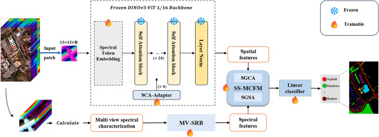

# HyperDINO
## HyperDINO: Towards Limited Data Hyperspectral Image Classification by Parameter-Efficient Transfer Learning

## News
-2026/11/23 Code is being organized and uploaded.
## Requirements
-Pytorch 2.xx.x
## Clone Repository
```shell
git clone https://github.com/Winkness/Segment.git
cd Segment
```
## Get Started Quickly
```shell
conda create -n Hyperdino python==3.x
conda activate Hyperdino
pip install -r requirements.txt
```
## Datasets
- [WHU-Hi-LongKou (LK)](https://rsidea.whu.edu.cn/resource_WHUHi_sharing.htm)
- [University of Pavia (PU)](https://huggingface.co/datasets/danaroth/pavia/tree/main)
- [Salinas (SA)](https://huggingface.co/datasets/danaroth/salinas/tree/main)
- [Houston (HU)](https://www.grss-ieee.org/community/technical-committees/2013-ieee-grss-data-fusion-contest/)
## Start
```shell
cd Hyperdino
python main.py
```
## Train
```shell
xxxx
```
## Test
```shell
xxxxx
```
### Citation

If you find HyperDINO useful in your research or refer to the provided baseline results, please star ⭐ this repository and consider citing
```
@article{JING2026135743,
title = {HyperDINO: Towards limited data hyperspectral image classification by parameter-efficient transfer learning},
journal = {Neurocomputing},
pages = {135743},
year = {2026},
issn = {0925-2312},
doi = {https://doi.org/10.1016/j.neucom.2026.135743},
url = {https://www.sciencedirect.com/science/article/pii/S0925231226031413},
author = {Yuxing Jing and Heng Wang and Yunan Wang}
}  
```
## Acknowledgement
#Pretrained Model
[DINOV3](https://github.com/facebookresearch/dinov3.git)
#Datasets
- [WHU-Hi-LongKou (LK)](https://rsidea.whu.edu.cn/resource_WHUHi_sharing.htm)
- [University of Pavia (PU)](https://huggingface.co/datasets/danaroth/pavia/tree/main)
- [Salinas (SA)](https://huggingface.co/datasets/danaroth/salinas/tree/main)
- [Houston (HU)](https://www.grss-ieee.org/community/technical-committees/2013-ieee-grss-data-fusion-contest/)
